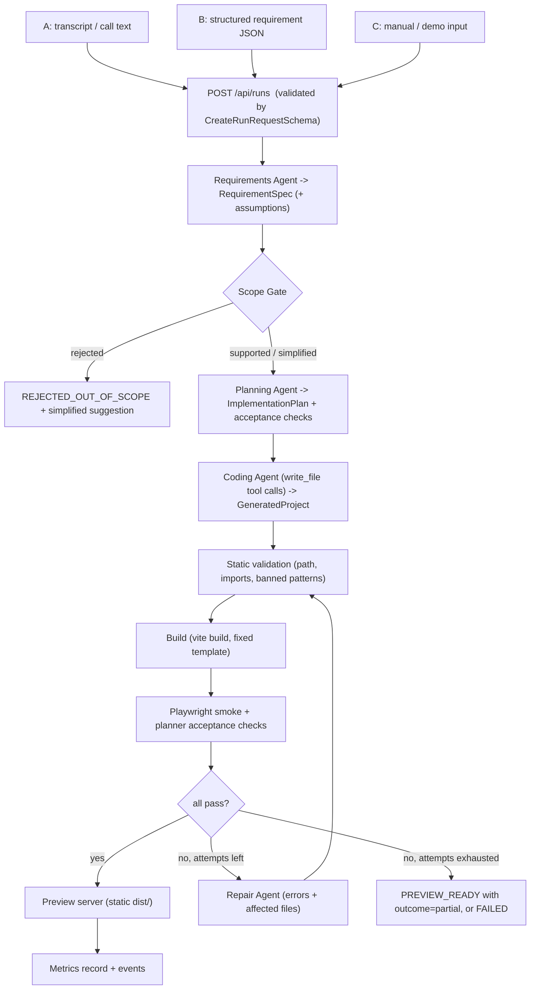

# Architecture (Phase 1 baseline)

**Contribution:** an autonomous requirements-to-MVP generation pipeline combining requirement extraction, structured planning, AI code generation, automated validation, acceptance testing and self-repair. **Research question:** do automated validation and self-repair improve the reliability of AI-generated web MVPs? Generated apps are *functional prototypes*, not production software.

## 1. Layers (strict one-way dependencies)

```
ORCHESTRATOR   coordinates stages, owns no business logic         server/src/pipeline
     |
AI AGENTS      requirements | planning | coding | repair          server/src/agents  (+ llm/ abstraction)
     |
VALIDATION     scope gate | static checks | build | Playwright     server/src/validation
     |
WORKSPACE      per-run folders, template copy, file writing        server/src/workspace
     |
PREVIEW        static server for built dist/ on its own port       server/src/preview
     |
METRICS        recorder + CSV export                                server/src/metrics
```
The orchestrator reads `PIPELINE_PROFILES[condition]` (shared) to decide which stages run, so baseline / proposed / blind_retry are data, not `if` branches.

## 2. Data flow


After the Requirements stage the flow is identical for inputs A, B and C. For B the Requirements Agent validates and *completes* the draft instead of extracting from text.

## 3. Run-state model

`CREATED -> EXTRACTING_REQUIREMENTS -> CHECKING_SCOPE -> PLANNING -> GENERATING_CODE -> VALIDATING_STATIC -> BUILDING -> TESTING -> PREVIEW_READY`
with `REPAIRING` reachable from VALIDATING_STATIC / BUILDING / TESTING (and returning to VALIDATING_STATIC or BUILDING), and terminal states `PREVIEW_READY`, `FAILED`, `REJECTED_OUT_OF_SCOPE`, `CANCELLED`.
Baseline goes `GENERATING_CODE -> BUILDING -> PREVIEW_READY|FAILED`.

`outcome` (set on terminal states): `success_first_try`, `success_after_repair`, `partial` (builds and previews but some checks still fail), `failed`, `rejected`, `cancelled`.
Transitions live in `shared/src/schemas/run.js`; every change goes through `server/src/pipeline/runStateMachine.js`.

## 4. API

| Method | Path | Purpose | Phase |
|---|---|---|---|
| GET | /api/health | liveness + LLM configured? | 1 (done) |
| GET | /api/config | secret-free config, scope lists | 1 (done) |
| GET | /api/demos | the 3 demo scenarios | 1 (done) |
| POST | /api/runs | create + start a run (input A/B/C, mode, condition) | 1 (stores run; stages from Phase 3) |
| GET | /api/runs | history list | 1 (done) |
| GET | /api/runs/:id | full run record | 1 (done) |
| GET | /api/runs/:id/events | SSE: replay + live progress | 1 (done) |
| GET | /api/runs/:id/files | generated file list / content | 5 |
| POST | /api/runs/:id/cancel | cancel a running run | 4 |
| GET | /api/metrics, /api/metrics/export.csv | per-run metrics | 11 |
| POST | /api/experiments | run the benchmark, per condition | 12 |
| (port 4001) GET | /preview/:id/ | built MVP, separate origin | 9 |

## 5. LLM abstraction

`llmClient` exposes `generateStructured()`, `generateText()`, `generateCode()`. A provider implements one method, `complete()`. Adapters for `anthropic` and `openai_compatible` arrive in Phase 3; `mock` exists now and powers the tests. Provider and models come from env vars. `generateStructured` retries once with the validation error fed back; `generateCode` receives files as `write_file` tool calls and validates them with `GeneratedProjectSchema`.

## 6. Locator contract (what makes checks machine-testable)

The planner writes checks using locators (`testid`, `role`, `text`, `label`). The coding agent is told to put `data-testid` on every element a check targets, and the planner's check list is part of its input in *all* conditions. Navigation uses hash routes (`#/menu`), so no router dependency is needed.

## 7. Replay mode (Phase 10)

Every LLM response is recorded under `demos/recordings/<scenario>/` keyed by `sha256(stage + model + canonical prompt)`. `RUN_MODE=replay` serves those; the build, tests and preview still run for real. The UI shows `Mode: LIVE` or `Mode: REPLAY` on every run and in the metrics export.

## 8. Dependencies

Phase 1: `express`, `cors`, `dotenv`, `zod` (server); `zod` (shared); `react`, `react-dom`, `vite`, `@vitejs/plugin-react` (dashboard). Tests use Node's built-in runner.
Later: `playwright` (Phase 7, dev dependency, one-time `npx playwright install chromium`), provider SDKs or plain `fetch` (Phase 3).
Template (Phase 5): `react`, `react-dom`, `vite`, `@vitejs/plugin-react`, pre-installed once and reused.

## 9. Folder structure

```
shared/        schemas, constants, pipeline profiles, run-state transitions (used by server + dashboard)
server/src/    config, api, pipeline, agents, llm, validation, workspace, preview, metrics, storage, events
dashboard/     React + Vite UI (placeholder in Phase 1)
templates/     locked React/Vite scaffold the LLM cannot modify (Phase 5)
demos/         scenarios.json (+ recordings in Phase 10)
benchmark/     20-30 items with held-out checks (Phase 12)
workspace/     gitignored: runs/<id>/{run.json, events.jsonl, project/, dist/}
docs/          this file, SECURITY.md, EVALUATION.md
```
